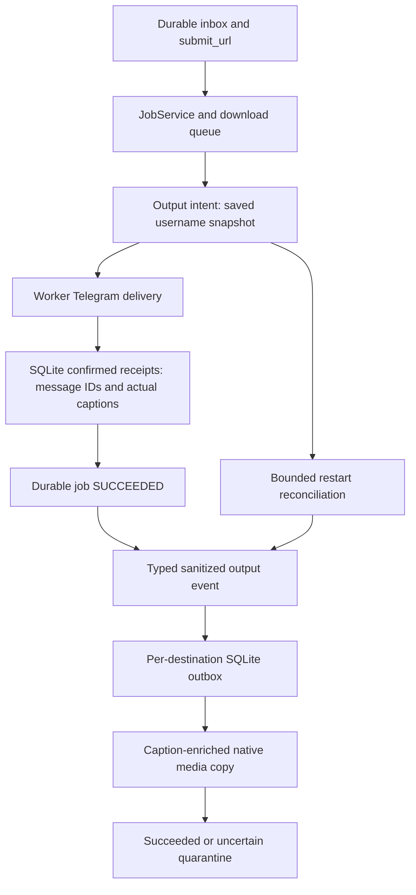

# Architecture

## System view

```text
Telegram user
    |
    v
aiogram bot process
    |
    +---- project Telegram runtime ---- public or migrated Local Bot API
    |
    | enqueue project-owned DownloadJob payload
    v
Redis / ARQ
    |
    v
worker process
    |
    v
DownloadService (application)
    |
    v
DownloadEngine port -> RoutedMediaEngine
                       |              |
                       v              v
               GalleryDlEngine    YtDlpEngine
                       |              |
                       v              v
              gallery-dl process  yt-dlp + ffmpeg
```

SQLite/WAL under `/data/state` is the durable control plane shared by the bot and worker. Redis is
the transient queue/rate-limit/membership-cache plane and is not the source of truth for completed
delivery state or user usage.

## Dependency direction

```text
telegram ---------> application ---------> domain
workers ----------> application ---------> domain
infrastructure ---> application ports ----> domain
bootstrap --------> all concrete adapters (composition only)
```

The domain layer imports no framework. The application layer does not import aiogram, ARQ, Redis,
or yt-dlp. Infrastructure implements application ports.

## Stable internal contract

The engine port exposes normalized project models:

- `MediaInfo` for inspection;
- `MediaFormatOption` for a real selected-stream candidate, normalized codec/geometry/size fields,
  and adapter-supplied selected-format identity;
- `NativeOptionView` for a deduplicated, public, non-transcoding Telegram choice;
- `OutputContainer`/`ContainerPolicy` for native-only or guaranteed MP4/WebM/MP3 output;
- `DownloadRequest` for semantic requests;
- `DownloadResult`/`DownloadArtifact` for one or an ordered set of final files;
- `ImageDeliveryMode` for an explicit Instagram photo-versus-document choice and
  `DownloadArtifact.source_index` for transient source-order reconciliation;
- `DeliveryProgressEvent` for packaging, byte transfer, and opaque finalization;
- project exceptions for failure categories.

Raw yt-dlp info dictionaries, extractor objects, hooks, and exceptions remain inside the adapter
package. Selected format IDs are normalized into an immutable project tuple for deduplication,
integrity validation, and structured logging; they never become callback data or user-facing raw
choices. Telegram callbacks contain only a short opaque option digest.

`MediaAsset` extends this contract with an ordered stable identity and safe normalized metadata.
It deliberately has no download URL. Gallery inspection is an unstable vendor event protocol
requested explicitly as JSON Lines and strictly parsed as gallery-dl message tuples entirely in
`infrastructure/gallerydl/`; SQLite/Redis retain only the canonical post URL,
semantic mode, stable asset IDs, and normalized metadata. Each queued download resolves current
authorization and credentials, then inspects once. `DownloadRequest.inspection` binds that validated
`MediaInfo` to the exact URL and resolved credential handle for reuse inside the same operation;
router and gallery download do not inspect again. Durable UI selections lack extraction-credential
provenance and are never accepted as download inspections. Signed/expiring asset URLs remain
adapter-local; the actual download still resolves them from the canonical provider URL.

A non-empty malformed event stream is an upstream output-contract failure. Empty output without
definitive provider evidence is ambiguous, terminal extraction failure, not proof of deletion or
session expiry. Explicit HTTP/auth/rate/network/GraphQL evidence retains typed failure semantics.
Instagram `img_index` is carousel presentation state,
so the engine inspects the canonical full post and stores only the removed parameter name, never
its value or tracking payload.

The router tries gallery-dl only for its supported social sources. An image-containing result makes
it owner of the post plan; a typed no-images result selects yt-dlp. For mixed Instagram posts,
gallery-dl is invoked with `extractor.instagram.videos=false` in an isolated image sub-workspace,
while yt-dlp first reads the canonical public parent's raw extractor entries with child processing
disabled. Photo entries are classified without being processed as videos; the adapter requires the
exact parent identity, total entry count, and video ordinals from the gallery plan, derives only
validated public Instagram child URLs, and strictly downloads each video in a separate video
sub-workspace. Video
resolution completes before gallery image download, so a deterministic plan mismatch cannot cause
duplicate image downloads on retry. The router maps videos back to safe source ordinals and merges
all artifacts before delivery. A malformed/bulk URL, authentication error, missing executable,
rate limit, schema change, count mismatch, or unsafe output fails closed and is never disguised as
video fallback.

Instagram selections containing images show an owner-bound `i2` callback with only the opaque
selection token and `ImageDeliveryMode`. The nullable semantic is stored on the durable job and ARQ
payload for backward-compatible recovery. Photo delivery chunks total source order into at most ten
photo/video album items. Document delivery uses ordered same-type runs because Telegram document
albums cannot mix with photo/video album items; singleton remainders use the matching direct API.
No production image is resized, converted, recompressed, or otherwise rewritten.

## Processes

### Bot

- long polling initially;
- validates public DNS results and static/durable user policy;
- enforces membership in every configured channel through a cached Telegram gateway;
- serializes inbound updates without outbound Bot defaults and journals them to SQLite in Telegram
  order before advancing the long-poll offset;
- treats an unresolved serialization gap as a hard batch barrier, so later updates cannot be
  persisted, replayed, or handled ahead of it; only a replayable row or durable terminal tombstone
  permits the offset to advance;
- upserts the Bot API user profile and request counters through a persistence port;
- creates a durable job record before its immutable queue payload;
- reads owner-bound, expiring selections for callbacks;
- does not download media;
- remains responsive while workers are busy.

Highlight delivery choices reuse owner-bound, expiring `SelectionRecord` state and the existing
`StoryDeliveryMode` job field. A direct Highlight URL is inspected by the worker before publishing
`h3` normal/file callbacks; a browser choice derives its canonical URL from an offered tray item
and retains the tray's expiry and authorization source. Callbacks reauthorize the source, create
the durable collection job, then enqueue it. The worker applies the persisted mode to both Stories
and Highlights; file delivery uses exact-byte documents for every ordered artifact. No schema or
configuration change is required. Explicit normal Highlight choices retain legacy idempotency keys
so an old uncertain delivery is not replayed after upgrade.

### Worker

- owns engine calls and local job directories;
- executes blocking yt-dlp calls via a thread boundary;
- publishes normalized inspection UI and uploads through a `DeliveryGateway` port;
- persists transitions, attempts, cancellation, and delivery receipts;
- maps download and delivery progress through a bounded, throttled presentation/logging channel;
- cleans temporary files;
- is deployed as one worker container until a leased multi-host store is introduced.

The worker passes the persisted `JobRecord.url` explicitly to the delivery port; the Telegram
adapter never queries SQLite. Caption composition preserves the existing renderer and adds the
canonical source line at the bottom after collection ordinals or multipart labels. Only title text
may be reduced to fit Telegram's 1024-character media-caption limit. If the fixed caption plus the
complete URL cannot fit, the media keeps its valid caption and the source line is sent as an
immediate reply after the media receipt is durable. Albums retain the existing full first-item
caption and put source-only captions on later items where Telegram permits them.

### Administrator presentation and analytics

`/start`, `/menu`, and refresh/back-to-menu reply buttons install the keyboard matching the sender's
current `telegram.admin_ids` membership and clear pending FSM state. Navigation buttons are not
members of the privileged management-button set; cached administrator navigation still recovers an
ordinary user's menu. `telegram/user_menu.py` owns the ordinary-user public/private download actions,
subscription/purchase entry points, and personal Instagram controls; `telegram/admin_handlers.py`
owns shared menu recovery, management, and the administrator-only `/panel`. Every management message
and callback repeats authorization; keyboard visibility and FSM state are never trusted. A denied
management message clears stale state and restores the ordinary-user keyboard; a denied logger
callback also clears stale state. Management refusals use a scoped message, not the whole-bot
access-policy denial. Menu recovery never bypasses allowlists, bans, membership, or download limits.

The admin download prompt injects the same `submit_url` callable consumed by the ordinary URL
router. Once a URL is accepted there is no admin-specific job, service, queue payload, worker,
delivery path, or storage root. The editable inspection-status message never carries a reply
keyboard; the persistent administrator keyboard is restored through a separate message so the
worker can replace the status with an inline selection. A rejected Telegram edit falls back to a
new tracked status message. Deduplicated active inspections are idempotently reconciled with ARQ
without creating another pending status message. The main keyboard remains available throughout
success, controlled failure, cancellation, and timeout.

Usage reporting follows `telegram -> application analytics port -> SQLite analytics adapter`.
The application service computes Tehran-local weekly, monthly, and 14-day breakdowns and filters
the current administrator IDs during aggregation only. Durable jobs and events remain intact.
Rendering is single-flight per administrator and produces an in-memory Pillow PNG; no report
input, media URL, administrator ID, or chart file is persisted. The renderer resolves Noto Sans
through `importlib.resources`, caches decoded font sizes, and fails with the project-owned
`UsageChartFontError` when the licensed resource is missing, empty, corrupt, or lacks required
ASCII glyphs. The wheel, sdist, and image carry the same font/OFL bytes, so charts have no
system-font, fontconfig, display-server, network, or external chart-service dependency.

The dashboard contract is 2200x1450 RGB PNG with an English/ASCII header, Tehran-local range,
generated timestamp, six KPI cards, named three-series legend, numeric Y axis, adaptive X-axis
dates, zero baseline, and selected bar values. English avoids introducing untested Arabic shaping
or BiDi behavior; Telegram captions remain Persian.

Cookie management follows `telegram -> application cookie-management port -> infrastructure
Netscape file adapter`. Only private messages from a currently configured administrator reach the
adapter. Telegram documents are streamed into a bounded in-memory buffer, so no upload filename or
temporary file becomes a trust boundary. The adapter updates the existing `yt_dlp.cookies_file`;
it does not introduce another runtime cookie source. The settings model resolves one effective
cookie path for yt-dlp (including SoundCloud) and every gallery-dl provider. Legacy non-null
`gallery_dl.cookies` entries are compatibility aliases and must resolve to that same path; divergent
stores fail configuration validation. Consumers reopen the canonical path for subsequent jobs, so
atomic replacement needs no container restart.

Media engines are read-only consumers of these authentication files. Every gallery-dl operation
sets `extractor.cookies-update=false`; nested yt-dlp receives only an in-memory cookie jar with
cookie-file persistence disabled. The direct yt-dlp runtime disables `save_cookies`, so concurrent
inspection/video jobs cannot save provider-mutated jars over the canonical or leased user source.
The administrator cookie manager remains the intentional shared-file writer. User vault leases,
owner/generation checks, restrictive materialization and cleanup remain unchanged. Media output
uses `job-root/media`; leased credential directories are siblings under `job-root` and cannot be
deleted by an adapter resetting its output. Terminal cleanup still removes the complete job root.

Gallery request retries belong to the worker, not nested extractor/downloader loops. Only observed
network/timeouts/server failures and rate limits are retryable. The existing attempt limit bounds
equal-jitter exponential delays with a 900-second ceiling; an observable Retry-After is a floor.
A cooldown beyond that window terminates with the original cause instead of making an early request.

The adapter strictly parses the Netscape seven-field format and maps normalized domain suffixes to
project-owned service identities. It serializes updates under a process lock, creates an atomic
hard-link backup in the private `.cookie-backups` directory, writes/fsyncs a same-directory
temporary file with the original owner/group/mode, and uses `os.replace`. Unrelated raw lines are
retained byte-for-byte; neither the application result nor structured logs contains cookie names,
values, domains, filenames, contents, or backup paths.

Static cookie health uses that same provider registry. Matching session records prove presence but
not authentication and therefore report `UNVERIFIED`, never `MISSING`. Replacement is verified for
canonical bytes, uploaded identities, provider counts, mode and POSIX ownership before success;
verification failure atomically restores the backup. The admin flow immediately persists a static
refresh for only the detected providers. Cookie Health never performs provider validation traffic:
there is no probe adapter, provider URL, startup probe, or worker cron. Worker startup, an admin
view/refresh, and a successful upload read only the canonical file. A real user-requested yt-dlp or
gallery-dl operation may persist `AUTH_FAILED` from the failure it already received, without a
second request. Upload clears that provider's stale runtime failure before the new local snapshot.
Legacy active-probe SQLite fields remain readable for compatibility, but old successful probe
evidence is discarded on the next static refresh and can never override local state.

## File isolation

Each job uses:

```text
/data/temp/<job-id>/
/data/downloads/<job-id>/
```

No user-provided title becomes a directory name. Output paths are resolved and checked beneath the
configured root. yt-dlp inspection additionally receives a private scratch workspace (an
`inspect-*` directory created per run under `/data/temp/`) and both `paths.home` and `paths.temp`
point at it, so format-probe temporary files can never fall back to the read-only application
directory; the engine deletes it when the run finishes, and the orphan sweep reclaims it after
the grace period if a crash leaks it.

Interrupted `running` jobs are requeued on startup. Jobs interrupted during `delivering` become
`delivery_uncertain`; automatic retry is blocked because Telegram has no upload idempotency key.
This trades a possible manual resend for prevention of an uncontrolled duplicate.

Cancellation is a durable-first state transition. The bot atomically marks an owned cancellable job
`cancelled` with `cancel_requested=1`, then requests official ARQ abort and removes finalized
enqueue/retry/in-progress/result state. ARQ workers enable abort support. Startup reconciliation
always converts legacy cancelled queued/running/retrying rows to `cancelled` and never enqueues them;
the operation is idempotent. A simultaneous user cancellation and worker shutdown resolves to user
cancellation, while an ordinary shutdown leaves a healthy pre-delivery job recoverable.

## Update isolation

Potential upstream compatibility changes are constrained to:

```text
infrastructure/ytdlp/engine.py
infrastructure/ytdlp/mapper.py
infrastructure/ytdlp/options.py
infrastructure/ytdlp/error_mapper.py
```

A genuine change to the project-owned engine port requires an ADR and coordinated tests.

## Extension points

- Additional engines implement the same port.
- Source-specific custom extraction belongs in an external `yt-dlp` plugin package.
- Storage can be replaced behind a future storage port.
- Queue implementation can be replaced without changing Telegram handlers.

## Large-file routing

- `<= telegram.max_upload_size_mb`: direct Local Bot API delivery.
- `> telegram.max_upload_size_mb` and `<= multipart.max_total_size_mb`: stored multi-volume ZIP
  documents, each bounded by `multipart.part_size_mb` and sent through Local Bot API.

Each multipart build owns an isolated 7-Zip process handle. Cancellation terminates only that
job's process group. After a Telegram item receipt is durably persisted, its volume or manifest is
unlinked immediately. The worker then applies idempotent, symlink-safe cleanup to the exact
`downloads/<job_id>` and `temp/<job_id>` directories on success, failure, cancellation, timeout,
and uncertain delivery. Cleanup errors are logged and counted but never replace the primary job
outcome. Startup and maintenance sweepers remove terminal workspaces immediately and unknown stale
workspaces only after the orphan grace period; active jobs and storage-root sentinels are preserved.

After a durable inspection/download job reaches `failed` or `delivery_uncertain`, the worker sends
one best-effort private alert to every unique current `telegram.admin_ids` entry. Intermediate
retries, cancellation, and successful jobs do not alert. The message is deliberately non-durable
and contains only the opaque job ID, job kind, normalized source label, terminal status, stable
error category, and attempt number; URLs, user/chat IDs, titles, paths, filenames, cookies, and raw
exception text never enter the message. Per-recipient failures are isolated and logged only as
aggregate counts and exception class names, so alert delivery cannot change the job outcome or
prevent zero-retention cleanup.

`best_original` is native-only and never transcoded. Public MP4 selection is a zero-transcode
container contract supporting AV1/AAC and H.264/AAC: codec families are planned independently
before quality/bitrate ranking, and the configured deterministic fallback either chooses the
highest lower resolution in that family or reports no compatible format. Public WebM selects native
VP9 + Opus. Every public video option is checked once
while building the catalog and again immediately before durable job creation; neither button starts
a codec conversion. Public video jobs retain the codec-family-filtered `GUARANTEED` contract: a
source-format change between inspection and download fails safely, while only
`EXPLICIT_TRANSCODE` may encode. The internal explicit-MP4 policy may still convert AV1/VP9 for non-public
administrative/development flows after a conservative timeout estimate accepts the work.

Container mux compatibility, Telegram inline-video streamability, and document delivery are
separate decisions. AV1/AAC MP4 is a valid native artifact and is delivered as a document when it
does not satisfy the H.264/AAC inline-video profile. `best_original` normalizes
every accidental guaranteed-container request to native-only before it reaches the adapter.
Transcoding first uses a quality-oriented CRF pass; the configured maximum is only a ceiling, and
bitrate limiting is a fallback when that pass exceeds the ceiling or would multiply a small
source's size.

Heavy transcoding is separately bounded from general worker concurrency: FFmpeg receives a real
encoder thread limit, a process-local semaphore bounds simultaneous encodes, a wall-clock timeout
terminates the process group, and an operator may disable forced conversion. Progress is parsed from
FFmpeg's machine-readable channel without exposing source paths. Docker can optionally add a worker
CPU quota through `.env`.

Fixed-resolution candidates are exact-height contracts except for the documented MP4 codec-family
fallback. The application planner labels only actual selected height/FPS/dynamic range/codecs and
deduplicates plans by selected streams plus those output properties. Thus several requested modes
that resolve to one 1080p stream produce one 1080p choice. Exact `filesize` wins over
`filesize_approx`; selected video and audio components are summed, bitrate/duration is only an
estimate, and incomplete metadata remains explicitly unknown.

Navigation callbacks are versioned (`c2`, `o2`, `n2`), owner-bound, expiring, and below Telegram's
64-byte limit. Back transitions form `quality -> output type -> send a new link`, edit the same
message, and read the existing SQLite selection. Legacy `container:`/`fmt:` callbacks never create a
job and instead redirect to the current Native menu.

Delivery reads through a tracked `InputFile`. Byte progress ends when the HTTP body has streamed to
Local Bot API. Since Bot API exposes no subsequent byte callback, final response waits emit only
elapsed-time heartbeats. Each successful multipart receipt is persisted before the next volume.

## Runtime control plane

The worker exposes internal-only `/health`, `/ready`, and Prometheus `/metrics` endpoints. Readiness
covers Redis, SQLite, writable storage, Telegram, ffmpeg, and the engine. Compose does not publish
the port to the host by default; the worker container health check consumes it internally.

Linux release updates run from an isolated script copy. While the current stack is still available,
they download and checksum the source assets, validate the complete staged Bash/Compose/config
payload, pull every candidate Compose image, and run the prepared image's configuration checker
with a read-only container root, read-only `config.yaml`, and the project's persistent data bind
mounted read-only at `/data`. This mirrors runtime path visibility and UID/GID without permitting
changes to cookies, SQLite, downloads, or Local Bot API state.

When the logger is enabled, this pre-stop read-only phase validates the existing SQLite database
and sidecars as filesystem objects and deliberately does not open SQLite, because a clean WAL
database may need to create `-shm` even for an otherwise read-only query. The post-stop Linux
offline doctor still opens the writable durable state and requires the full logger health snapshot.
The Windows updater has no read-only bind-mount phase and retains its full post-install doctor.

Fresh installers and Linux/Windows updaters carry a small embedded snapshot of the canonical
`release-policy.json` denylist because each bootstrap must remain independently executable. Tests
require all snapshots to match the canonical file. A requested blocked tag fails before download;
the verified archive's package version is checked independently so aliases cannot bypass the
policy. Candidate rejection occurs before install/configuration/state mutation, image pull, or
service stop. The policy applies to the target, never the installed version, which preserves a
forward-recovery path from a withdrawn release. Publication and archive construction consult the
canonical policy directly. A hosted revocation service is intentionally unnecessary for this
single known withdrawal and would add a new availability/trust dependency to recovery tooling.

The updater records the exact running set of `bot`, `worker`, `local-api`, and `redis`, then stops
only running filesystem writers (`bot`, `worker`, and `local-api`). Redis remains online in its
persistent named volume. The resulting private backup is written to a same-directory temporary
archive and atomically renamed only after tar succeeds. It includes `config.yaml`, `.env`, cookies,
SQLite state including present WAL/SHM files, and durable Local Bot API state. Downloads and temp
remain untouched in place and outside the archive; only the explicitly audited volatile
`data/telegram-bot-api/telegram-bot-api.log` is excluded, never a wildcard class of logs.

Top-level application entries use rollback snapshots while local configuration/state remain outside
replacement. Verification is explicitly phased. Candidate preflight parses configuration and runs
the complete static doctor in the prepared read-only image. After installation, a same-UID
filesystem write and SQLite WAL probe plus the same fail-closed offline doctor verify Python/package
version, yt-dlp, gallery-dl, canonical cookies, ffmpeg/ffprobe, Deno, Local API static state,
chart/font resources, and 7-Zip without probing any stopped project service. The updater then starts
only writers that were running originally, waits for Compose health, and runs selected online checks:
Local API reachability only for a restored `local-api`, and bot/required-channel Telegram checks only
for a restored `bot`. It finally requires an exact four-service state match. The ordinary operator
`doctor` remains the full static-plus-live diagnostic. Any
post-stop failure restores the prior source, image, usable permissions, command link, and original
service state; intentionally stopped services remain stopped. Failure output identifies the stage
and includes only bounded sanitized diagnostics. Image-pin rewrites retain the pre-existing numeric
owner/group and mode of `.env`, including when an authorized operator invokes the updater through
`sudo`.

An installed updater cannot consume corrected transaction code from inside the release archive
until that old updater finishes its own transaction. Patch releases therefore publish
`tmb-updater.sh` with its own SHA-256 file. Affected v1.2.1, v1.3.0, and v1.3.1 installations verify and
execute the corresponding release asset once against the existing project root; the normal
transactional install then places the corrected updater for every later `tmb update`.

Only after offline static checks, selected post-start online checks, candidate health, and exact
Compose service state pass may
the updater clean Docker resources. It removes stopped containers from this Compose project only
when they use a superseded image, then removes unreferenced image IDs whose repository is exactly
`ghcr.io/hamedsanaei/telegram-media-downloader-bot`. The current image, images referenced by any
container, other repositories, volumes, and build cache are outside its authority. The same
operation is exposed as `tmb cleanup --dry-run`.

## Telegram endpoint control plane

`infrastructure/telegram/local_api.py` owns managed server lifecycle, migration state, endpoint
leases, safe status, and public/local transitions. `telegram/bot_factory.py` is the shared Bot/Worker
composition point. Both processes resolve the same endpoint from YAML plus durable migration state.
Cross-process leases reject mixed endpoints and keep a managed server alive until the final local
client exits. Migration writes its intent before each non-idempotent `logOut`; an uncertain result
is quarantined and never repeated automatically.

The Docker topology can assign Local API lifecycle ownership to a dedicated `local-api` service.
That service reads credentials from mounted YAML and injects them only into the official child
process environment. Bot and Worker connect through `http://local-api:8081`; no credential is
placed in Compose environment or command arguments.

## Source-specific policy without handler coupling

Source detection remains inside the yt-dlp adapter. The worker consumes normalized `source` policy:
Instagram collections are the approved automatic multi-artifact flow, image entries are discarded,
and ordered video artifacts are delivered separately. With `force_mp4`, the adapter selects the
best native MP4 video and M4A audio and only merges/remuxes them; without it, the source-selected
container is preserved. Cookies remain an optional restricted operator file, writable only by the
runtime identity when administrator cookie management is enabled. Telegram handlers
contain no extractor/domain-name dispatch chain.

## YouTube URL intent boundary

The framework-free application canonicalizer recognizes only explicit YouTube host and video-path
shapes. A valid 11-character video ID takes precedence over a `list` query parameter: Mix-related
parameters are removed before SQLite persistence, ARQ enqueue, inspection, and download. Explicit
`/playlist?list=...` URLs remain playlists. The worker and yt-dlp engine canonicalize again so
legacy persisted or retry payloads cannot bypass the rule.

For defense in depth, yt-dlp receives `noplaylist=true` in both inspection and download whenever
single-video intent is present. Canonicalization happens before any extractor or Deno work. The
structured `youtube_url_canonicalized` event includes validated IDs and a sanitized original URL;
unknown query keys and their values are excluded from logs.

## Agent context control plane

Repository navigation is an additive development-time layer and has no runtime path into the bot,
worker, media engines, database, queue, image, or release artifacts. Root `AGENTS.md` retains the
global engineering contract. Compact files under `docs/agent/` route a task to the existing
authoritative specification, architecture, ADRs, status, source, and tests.

Graphify uses the repository-scoped `.graphifyignore` and an ignored, checkout-local
`graphify-out/` index. Bounded queries locate symbols, dependency paths, reverse relationships, and
candidate tests. The graph is not authoritative and is refreshed after structural changes; no
Graphify package, service, network call, or generated graph is required at production runtime or in
CI. `scripts/agent_context.py` provides a deterministic standard-library fallback, while
`scripts/check_agent_context.py` protects the progressive-discovery contract without imposing an
arbitrary documentation size ceiling.

## Milestone 4 architecture: VIP and authenticated Instagram

**Status:** T014-T025 are **implemented** end-to-end (see also `docs/STATUS.md` "T024/T025 runtime
milestone"): entitlement and billing foundations, the least-privilege companion with per-provider
payment callbacks, encrypted credential vault, account connection, credential resolution,
VipAdminService, the real payment gateways (UniquePay/Tetraminator/HooshPay), and the
USER_ONLY private-media policy with zero operator fallback. `FakeInstagramSessionAcquirer` is
test-only; production uses `RealInstagramSessionAcquirer`.

### Runtime system view

```text
Telegram /vip and account-link UI
        |
        +--> EntitlementService --> SubscriptionRepository ----+
        |                                                       |
        +--> BillingService --> PaymentGateway port             | SQLite/WAL
        |                       ^                                | durable truth
        |                       |                                |
        |               infrastructure/payment/<provider> ------+
        |
        +--signed owner handoff--> least-privilege aiohttp companion
                                      |                 |
                                      |                 +--> verified payment callback
                                      v
                         EncryptedInstagramCredentialRepository
                                      |
Telegram/worker policy --> CredentialResolver/lease/materializer
                                      |
                           job-scoped Netscape cookie
                                      |
                        RoutedMediaEngine -> gallery-dl / yt-dlp
```

The companion is a separate optional process and does not receive the Telegram bot token. Its
Instagram browser routes and payment webhook routes use separate middleware, request models, rate
limits, and application ports. Ed25519 handoff tokens are five-minute, owner/purpose bound,
fragment-delivered, POST-exchanged, and nonce-consumed once. Browser flow state, passwords, and 2FA
codes remain in memory for at most ten minutes. Payment callbacks require provider signature and
replay verification; browser redirects are presentation only.

Personal connection activation is explicit (`instagram-setup`); the main ignored `config.yaml`
remains authoritative. Provisioning preserves existing keys, refuses a new vault key when encrypted
rows already exist, and writes a private reduced `companion.local.yaml` without bot token, signer,
or payment secrets. The separate `docker-compose.companion.yml` mounts only that projection and
the shared SQLite state directory, publishes loopback port 8090, and does not join the core
updater's four-service lifecycle. Management writes fail closed while this installed companion is
running or its state cannot be checked; operators stop it before backup/update/restore and recreate
it explicitly after upgrading. See [the activation runbook](INSTAGRAM_CONNECTION.md).

The transient flow allocates a real provider acquirer/cookie jar per browser. Username is retained
only for its bounded 2FA continuation; passwords/codes are forwarded once. A provider thread only
acquires a result; the still-authorized, unexpired asynchronous flow commits the encrypted session
after completion, so a provider thread finishing after request cancellation cannot publish it.
The transport restricts redirects to Instagram HTTPS, processes every Set-Cookie header through a
cookie jar, and preserves quoted cookie values when producing Netscape session bytes.

### Implemented entitlement foundation (T014)

SQLite stores a plan catalog (`subscription_plans` + capabilities), a per-user subscription
projection, and an immutable entitlement-grant ledger plus a nullable job entitlement-snapshot
field. Redis never becomes economic truth. The commercial plan catalog starts empty and no price
is invented.

Plans use arbitrary positive calendar-month durations and typed `Capability` values
(`instagram_private_media`, `instagram_user_session_preference`). UTC month arithmetic clamps
invalid destination days. Renewal/stacking starts after `max(confirmation, preceding expiry)` and
is deterministic. Reversal marks a grant ``reversed`` — never deleting the audit row — and
recomputes the remaining confirmation-ordered chain; if no valid paid time remains, access ends
immediately. Financial records are retained indefinitely and excluded from media cleanup. Free
users require no subscription row.

`EntitlementService.authorize(user_id, capability, accepted_at)` accepts only against a typed
active entitlement, otherwise raising a typed denial (inactive / expired / cancelled / no-valid
grant / capability-missing) and failing closed (`EntitlementBackendError`) when the repository is
unavailable. Telegram's `UserProfile.is_premium` is never consulted. A protected request
successfully authorized and durably accepted persists an immutable `EntitlementSnapshot` on its
`JobRecord`; automatic child jobs inherit it, while a later user callback is a new request that
must reauthorize. Subscription expiry never invalidates an already accepted snapshot, but
credential revoke/disconnect (T017+) remains an entirely separate authority.

### Billing state

T015 implements a provider-neutral billing foundation: payment orders, attempts, and unique
provider transaction references (`payment_orders`, `payment_attempts`,
`provider_transaction_claims`). Confirmation and refund each use one immediate transaction for
verification, order transition, unique transaction claim, entitlement grant change, and
subscription recomputation. Configured real gateways are registered with the same `BillingService`
used by Telegram checkout and reconciliation. With no enabled plan/provider, the user dashboard
remains informational and creates no payment order; redirects never activate a subscription.

### Runtime credential boundary and policy

The business vocabulary is:

```text
CredentialKind: NONE | OPERATOR_PUBLIC | USER_INSTAGRAM
CredentialPolicy: OPERATOR_PUBLIC | USER_FIRST_PUBLIC_FALLBACK | USER_ONLY
ContentAccessScope: PUBLIC | USER_RESTRICTED | UNKNOWN
```

The canonical cookie file is the superadministrator-managed shared credential for public providers,
including Instagram. An Instagram owner with a connected session instead selects
`USER_FIRST_PUBLIC_FALLBACK`, independently of VIP. The historical zero-follow attestation records
remain readable but are not an activation requirement for this explicitly shared cookie policy.

Each user credential is a distinct owner/generation AES-256-GCM envelope. The key ring lives outside
SQLite in ignored least-privilege YAML. SQLite stores ciphertext, state, safe timestamps, sanitized
events, and one expiring lease; it never stores a password or 2FA code. Disconnect/revoke erases
ciphertext. Events retain 90 days and expired handoff hashes/leases purge within 24 hours.

The application selects one safe credential reference. The resolver verifies job owner, credential
owner, generation, state, and lease before materializing a restrictive cookie file inside that
job's workspace. The worker passes one explicit ephemeral context through inspection, router,
gallery images, yt-dlp video children, and download. Adapters know no subscription/VIP rule.

Public inspection, profile/Highlight resolution, images, native video children, and downloads use
the same owner session within an attempt. The first decision and exact generation are frozen on
the durable job. On a typed session/authentication failure, a conditional owner/generation update
marks only that session expired; reconnect guidance is attempted once per state transition. A
public job commits its one operator fallback before extraction, and retry/restart preserves it.
Empty output, local/media/size/schema/delivery/cancellation failures never switch credentials.

Private/restricted media is `USER_ONLY` for inspection through delivery. The connected account must
already have visibility. Unknown scope fails closed without existence disclosure. The operator
credential cannot be resolved after `USER_RESTRICTED`, including during retry/recovery.

### Persistence, recovery, and observability

Jobs persist owner-bound entitlement snapshots plus safe credential policy/generation, access scope,
attempt phase, and fallback state. Legacy snapshot JSON remains readable, but a private job missing
its owner, capability, `USER_ONLY`, restricted scope, or exact positive generation fails closed.
Selections and Highlight trays persist `source_job_id`; retention keeps that authorization source
until the choice expires. Later callbacks reload the source and reauthorize current entitlement and
generation. No cookie/ciphertext/password/code enters durable jobs, selections, ARQ payloads, logs,
metrics, Telegram, or failure summaries.

Per-user session failures update only that owner/generation. Reconnect may make eligible same-owner
jobs available for one bounded recovery; explicit revoke, cancellation, and delivery uncertainty
remain terminal authority. Operator failure continues through provider-level passive Cookie Health.
SQLite remains durable truth through restart/Redis loss.

Metrics use bounded state/capability/outcome/provider labels only. Telegram user IDs, Instagram
usernames, URLs, cookie values, credential/job/order/transaction identifiers, and upstream error
text are forbidden labels. Admin actions are role-authorized, sanitized, and audited.

### Rollout boundary

Purchasing and personal Instagram connection remain opt-in through existing configuration. The
ordinary-user menu and subscription status remain usable with purchasing disabled; missing plans or
gateway configuration cannot create unusable orders. Backup/restore includes SQLite/WAL/SHM,
canonical cookies, companion configuration, signing keys, and the vault key ring. Additive nullable
selection/tray source columns and owner-aware snapshot JSON preserve legacy public state.

This architecture is unrelated to and must not resurrect ADR-013's removed Telegram Premium,
Telethon/MTProto session, staging-channel, Premium queue, or copy-message delivery path.

## Milestone 5 architecture: Operator Logger and private audit channels

**Implementation status:** T026-T032 implemented and feature-gated off by default.
Repository initialization and config-destination reconciliation run at bot and worker
startup; pre-delivery output intents and confirmed receipt captions drive successful-output
mirroring. Acceptance does not enqueue logger media or metadata effects.

### Flow



Terminal operational failures and persisted Cookie Health transitions retain their independent
text-event paths. The dispatcher owns fan-out, leases, retry classification, and destination health;
it never changes job status, cancellation precedence, receipt authority, usage, or cleanup.

### Ownership and boundaries (T026/T027)

- `domain/audit.py`: framework-free categories, severities, event identity, safe metadata, and
  source-message references (implemented).
- `application/ports/audit.py`: audit repository, destination management, durable outbox, lease,
  and Telegram delivery-effect contracts (implemented).
- `application/services/audit_service.py`, `audit_sanitizer.py`, `audit_outbox.py`: eligibility,
  centralized fail-closed sanitization, correlation, and transport-neutral outbox processing; no
  destination IDs in business policy (implemented).
- `infrastructure/persistence/sqlite_audit.py`: additive SQLite/WAL destination, outbox, lease,
  health, and delivery-effect repository. SQLite/WAL is durable truth; Redis only wakes work
  (implemented).
- `infrastructure/telegram/audit_destination_verifier.py`: typed channel probe proving existence,
  channel type, bot membership, and posting permission with a sanitized test message; no raw
  Telegram exceptions surface (implemented T028). Native `copyMessage`/`copyMessages` delivery is
  implemented by T030 and wired into the worker dispatcher by T032.
- `telegram/admin_menu.py` and `admin_handlers.py`: role-authorized logger-channel management;
  callbacks reauthorized and validated at execution time (implemented T028).
- `workers/settings.py` and `workers/jobs.py`: `AuditService` wiring plus typed terminal-error/
  Cookie Health event emission; no `telegram.admin_ids` fallback (implemented T029). A separate
  30-second cron drains at most 20 logger effects, records bounded aggregate metrics/health, and
  keeps dispatcher faults outside download outcomes (implemented T032).
- `application/services/delivery_output_audit.py`: output-mirror admission, durable-intent
  reconciliation, ordered delivered-receipt filtering, and deterministic per-job identity. It is
  independently isolated from user completion and never reads local media for logger delivery.

Configured destinations and runtime-created destinations reconcile as a deduplicated union by
numeric `chat_id`. Config-managed rows cannot be removed through the runtime API or the T028 admin
UI (both preserve this). Destination health is `ACTIVE`, `UNREACHABLE`, `FORBIDDEN`, or `DISABLED`;
removal
or permission loss affects only that destination.

### Audit content and privacy boundary

`ERROR`, `COOKIE_HEALTH`, `USER_SUBMISSION`, and `SYSTEM` events carry UTC timestamp, correlation/
request/update ID, job ID when known, content/provider classification, sanitized message, source
message references, and the explicitly selected numeric Telegram user ID. The central sanitizer
redacts cookies, passwords, 2FA, authorization headers, bot tokens, filesystem paths, raw
exceptions, Instagram sessions, payment secrets, and signed login tokens while preserving approved
numeric user IDs.

Successful output events derive ordered IDs and exact caption snapshots from durable confirmed
receipts, with an insert-once optional username captured before user delivery. Descriptions pass the
same fail-closed secret policy while preserving line breaks. Native copies add escaped HTML identity
and safe complete canonical URL footers within 1024 UTF-16 units; bulk copies remove original captions
before mapped edits. No separate metadata message or accepted-input copy remains. Mirroring requires
explicit operator privacy attestation
(`operator_privacy_attested`), a usable private destination, and nothing else: since v1.4.0-rc.2 the
exact Persian disclosure is informational only (`/privacy`) and no per-user acknowledgement is
required, requested, or consulted in the acceptance path. Legacy acknowledgement rows are retained
for backward compatibility and are never read. Audit copies/safe metadata are retained
indefinitely; no automatic Telegram deletion is introduced and media-workspace cleanup remains
independent.

### Reliability and rollout

The outbox records work before normal processing continues. Telegram ambiguity is represented as
`UNCERTAIN` (or equivalent quarantine), never an automatic duplicate; uncertain sends are never
auto-resent. The T030 transport classifies copy outcomes; T032 wires its bounded,
per-destination, restart-safe dispatcher. With no
usable destination, the system emits only structured application logs plus bounded health/metric
signals.

Rollout is additive and feature-gated: initialize dormant state, validate private channels and
permissions, enable operational alerts, show the privacy notice, then enable successful-output
mirroring. Additive caption/username migrations preserve operator state. Initialization retires only
pending/retryable/leased historical input effects; sending/succeeded/uncertain history and old group
rows remain untouched. Local missing-context/identity/retirement failures never forbid a destination.
Backups include SQLite/WAL/SHM and logger state. Rollback restores prior configuration
without deleting audit history and leaves all existing inbox/effect/job/cookie-health behavior
authoritative.
